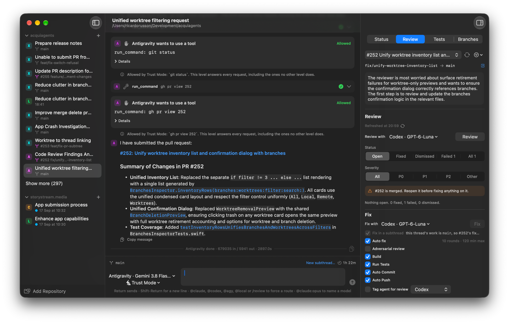

#  Kulula

Your AI coding subscriptions, working together in one native Mac app. Use Claude Code, Codex, Google's Antigravity CLI, Grok Build and Apple's on-device model to write code, review pull requests and run recurring tasks — with one conversation history and controls over what agents can do.

**Bring your own subscriptions. Kulula adds no subscription of its own.** Connect the command line tools you already use and keep using your existing provider accounts.

## Install

Download the latest `.dmg` from [Releases](https://github.com/ricruss/kulula/releases), open it and drag the app to Applications. The app is signed with a Developer ID certificate and notarized by Apple. It checks this feed for updates once a day and never installs one without asking.

## Why Kulula?

- **Use several coding agents in one workflow.** Choose an engine and model, let on-device routing choose, or hand a conversation to another engine with a brief of the work so far.
- **Get a second opinion before you ship.** Bring review findings into a worklist, ask another engine to assess them, and work through fixes, tests and re-review.
- **Put recurring work on a schedule.** Run repository prompts on a timetable, inspect each run, and continue the result in chat.
- **Work on separate changes in separate worktrees.** Give a conversation its own branch and checkout, with checks that keep actions on the intended branch.
- **Keep tests and fixes moving.** Queue project tests and use Auto Fix for bounded rounds of fixes, builds and tests.
- **Choose how much to delegate.** Use approval cards for hands-on control or select a security level for more autonomous work, with decisions visible in the transcript.
- **Keep unattended commands contained.** macOS sandboxing limits where app-run builds, tests and other unattended commands can write, including in Trust Mode.

## Bring your own subscriptions

Kulula uses your installed coding CLIs and their existing logins. If you already use Claude Code, Codex, Antigravity or Grok Build, you can bring those accounts into one app. Install and connect only the engines you want to use.

Provider plan limits and billing still apply; Kulula does not include model usage or add a subscription of its own. Apple's on-device model handles routing and short local turns. Grok Build can also use your xAI API key, and the optional model-based approval assessment uses your OpenAI API key; API usage is billed separately by the provider.

## One window, five engines

Add a repository, start a thread, type. Kulula runs the command line tools you already have — `claude`, `codex`, `agy` and `grok` — as background processes and renders what they do in a single transcript: text, collapsible reasoning, tool calls with their output and exit code, and diffs per file. Apple's on-device model answers the short turns itself.

Threads sit in the sidebar under their repository, each showing which engine answered last, a spinner while a turn runs and a badge while something is waiting on you.

## Routing, and overriding it

Every turn is routed on device: quick questions stay local, edits go to Claude Code, second opinions go to Codex. The route and the reason for it show above the composer, and one click sends the same turn elsewhere.

To choose yourself, name the engine: `@claude`, `@codex`, `@agy`, `@grok` or `@local`. Add a model to pin it for the thread, as in `@claude:opus`.

## Approval cards

Nothing is written, run, committed or posted without a decision, and the app makes that decision itself rather than handing the question to the engine. By default it is yours: a card shows what was actually asked for, the command and its arguments, the paths it touches, the diff it wants to apply, and you allow it, allow it for the session, allow it from now on, or deny it. The security level below sets how many of those cards you see.

A standing grant covers the program and the paths it reaches rather than the text you approved, so approving one command does not let a differently spelled one through. Commands that provably only read need no approval. Grants stay listed and revocable in Settings.

When an engine wants to ask you something rather than ask permission, that arrives as its own card and waits for a real answer.

## A security level to match the task

One control in the composer sets how much the app answers on your behalf.

| Level | What it does |
|---|---|
| **Always Ask** | Asks for every call. Your grants are kept but not consulted. |
| **Approval Mode** | The default. Asks for everything except commands that provably only read, and the rules you made with "Always allow". |
| **Auto Mode** | Allows anything confined to the repository, including file writes and local git. Discarding uncommitted work still asks, and so does anything that leaves the machine. |
| **Trust Mode** | Answers every request with no card at all, pushing and publishing and merging included. Confirmed once, by name, before it takes effect. |

Below Trust Mode, merging a pull request, releasing and any request to widen the app's own permissions always ask. Trust Mode is the level that answers those, for when you have decided to let an engine finish a job unattended. It stores nothing and touches none of the rules you have made, so leaving it takes every answer back from the next request onward, and each answer it gives appears in the transcript naming the level that gave it.

A question card is the exception: it appears at every level, Trust Mode included, since there is no answer the app could invent on your behalf.

### Sandboxed execution

Approval controls decide whether an action may proceed. For commands Kulula runs unattended, macOS also enforces where they can write. Builds and tests are confined to the workspace, the per-user temporary directory and system device paths. App-managed Git operations can additionally write to the specific Git metadata paths needed for a linked worktree.

This protection stays in place at every security level, including Trust Mode. If the sandbox is unavailable, Kulula refuses those commands rather than running them unconfined. Reads outside the workspace remain possible, subject to macOS permissions: this is write containment, not a promise that commands cannot read other files. Provider CLIs also have their own execution and permission mechanisms.

### Asking a model before asking you

Set an OpenAI API key in Settings and Auto Mode gains a step: an otherwise unclassified shell command whose arguments stay inside your repository can go to a model for an assessment rather than straight to a card. That one call is allowed if it comes back safe enough. Anything less, an error, or an answer it cannot read still shows you the card.

Some things never reach the model. Any program the app already has a rule about is one, so no assessment can allow `curl`, `sudo`, `git push` or a package install; so is anything whose arguments reach outside the repository, and any command line carrying what looks like a credential. Nothing is remembered either way, and every assessment appears in the transcript with the result it gave. None of this runs until you set the key.

## The pull request review loop

The inspector's Review tab turns a review into a worklist. Kulula watches the open pull requests on the current repository, and when a review arrives it groups the findings by severity with a file and line for each, including the ones left in replies and in the body of the review itself.

Per finding: fix it with an engine, ask Codex for a second opinion, reply only, or dismiss it. "Fix all" works a severity at a time. Fixes run in the thread you are already in, with the usual cards, and the diffs render inline.

Shipping is one card: a commit message drafted on device, the push, and a reply on each finding. Approve, edit or skip each line, and the exact `git` and `gh` commands are shown before anything runs. A shipped fix resolves its review thread, so GitHub stays the record of what is still open and a thread someone reopens brings its findings back. Asking for a fresh review is the last step.

Open, Fixed, Dismissed and All filters each carry a count, and merged pull requests stay hidden until you ask for them.

## Auto Fix

The same loop left to run, with a cap on rounds and on minutes that both count down on screen. A round is fix, build, test, and optionally a fresh review. It stops on either cap, on a round that changed nothing, or on a build that fails. It works within the permissions you have already given and never grants itself anything, so on a machine with no grants it is exactly as interactive as clicking Fix yourself.

## Test queue

The Inspector's Tests tab brings project test runs together. Kulula discovers individual tests where the project supports it, so you can run a single test or the full suite and see which tests passed, failed, have not run yet, or need rerunning after a change.

Runs started from the Tests tab, requested by an engine, or started by Auto Fix share a queue. You can choose how many runs happen at once; others wait their turn, and the checkout stays protected while a test process is still using it. Engines can request tests by their listed identifiers and get the result back in the thread. Test commands remain subject to the usual approval and workspace protections.

## Scheduled tasks

Turn a prompt into a recurring task for a repository: a morning summary of recent changes, a weekly review of test coverage, or a regular check for documentation that needs updating.

Open Schedules in the sidebar and add a schedule under a workspace. Set the prompt, choose an engine and model or leave routing on Auto, then choose a time zone and recurrence: every few minutes, daily, weekly, monthly, annually, or a custom five-field cron expression. The editor previews the upcoming occurrence.

Use **Run Now** to try a schedule immediately, or disable it to pause future runs. Each run has a status and a linked conversation in its schedule's history. Open a completed run and choose **Continue in Chat** to follow up on its findings.

Schedules run locally while Kulula is open and your Mac is awake. Missed occurrences are not replayed, and an occurrence is skipped if that schedule is still running. Scheduled turns use the app's current security mode and normal approval flow; the security control in the editor changes the app-wide mode, not just that schedule. A run can wait for your approval or an answer to a question.

## Branches and worktrees

The Inspector's Branches tab brings local and remote branches together with their worktrees. Search and filter the inventory, see matching pull requests and whether a checkout has local changes, and refresh the view as work progresses.

Start the current conversation in a new worktree to give it an isolated branch and checkout, or start a subthread in a new branch or an existing worktree. Existing threads and their work are left in place. Before deleting a branch or removing a worktree, Kulula previews what will be affected and checks for active threads and uncommitted changes; it will not discard local work as part of cleanup.

## Threads that stay on their branch

A thread is bound to the branch it works on and, when the work came from a review, to its pull request. Before a fix, commit, push, reply or merge, Kulula checks that the branch, the pull request and the checkout agree. If they do not it blocks the action and offers a way back rather than acting on the wrong code. Reading and discussing another pull request stays safe.

Switching the checkout needs a clean tree and no running turn, and is previewed first. Work you have not committed is never stashed or discarded for you.

## Handoffs, and picking up where you left off

When a thread moves to another engine, the on-device model writes a short brief — the goal, the files touched, what was decided, what is still open — and hands it over, since neither engine can see the other's context. The brief appears in the transcript.

Conversation history and approval grants are stored locally. Reopen Kulula to pick up your threads, with provider session resume where supported. Requests sent to a cloud engine are still processed by that provider.

## Engine status

The Status tab lists each engine, whether it is available, the plan usage it reports, and a warning when an installed tool has drifted from the version the build was tested against.

## Requirements

- macOS 26 or later with Apple Intelligence enabled.
- The `claude`, `codex`, `agy` and `grok` command line tools installed and logged in for the engines you want to use. Grok Build can also use an xAI API key saved in Settings.
- Git and the GitHub CLI (`gh`) installed and available on your `PATH`.

Kulula runs on the plans you already have and adds no subscription of its own. Antigravity needs a one-time approval hook, which Settings installs for you.

## Terms

The binaries are provided as is, for personal use, all rights reserved. No warranty.

